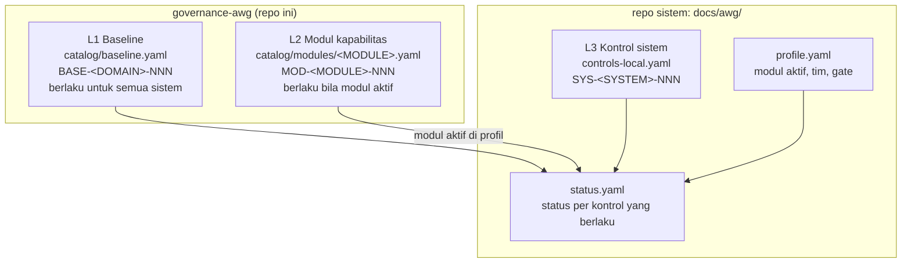

# governance-awg

Standar kualitas, keamanan, dan privasi Architecture Working Group (AWG) untuk sistem Program Capstone Cibenda: **SID** (SIDUTama), **CIMART** (CibendaMart), **SIGAP**, **VDASH** (Village Dashboard), dan sistem baru di masa depan.

Repo ini adalah **satu-satunya sumber definisi kontrol**. Status kepatuhan tiap sistem tidak disimpan di sini, melainkan di folder `docs/awg/` repo masing-masing sistem, dan diperiksa dengan validator dari repo ini.

Versi saat ini: **v2.0.0** ([CHANGELOG](CHANGELOG.md)). Migrasi dari v1: [MIGRATION.md](MIGRATION.md).

## Dua cara pakai

Standar ini bisa dipakai dalam mode **`team`**, yaitu beberapa tim saling memverifikasi secara rotasi dengan Coordinator sebagai verifikator kedua dan penyetuju waiver, atau mode **`solo`**, yaitu satu orang atau satu tim memakai standar ini sendiri tanpa tim lain maupun Coordinator terpisah. Mode hanya mengubah *siapa* yang memverifikasi; kontrol yang wajib sama persis. Mode dideklarasikan di blok `governance` pada `docs/awg/profile.yaml` (tanpa blok = `team`). Detail: [framework 09](00-framework/09-operating-modes.md).

| | `team` | `solo` |
|---|---|---|
| Cocok untuk | Program dengan beberapa tim dan Coordinator (mis. Capstone Cibenda) | Proyek di luar program, proyek klien, proyek pribadi |
| Verifikasi | Tim rotasi + Coordinator domain untuk kontrol `critical` | `self_review` di sesi terpisah dan/atau `external_reviewer`; tidak independen |
| Waiver & gate | Disetujui Program Coordinator + Coordinator domain; gate diputuskan Program Coordinator | Disetujui `owner` (waiver ke-3 dst. wajib external reviewer); gate diputuskan `owner` |

## Model 3 lapis



```
Kontrol yang berlaku untuk satu sistem
= L1 semua BASE  +  L2 MOD dari modul yang aktif di profile.yaml  +  L3 SYS di controls-local.yaml
```

## Peta direktori

| Path | Isi |
|---|---|
| [00-framework/](00-framework/) | Aturan main: ruang lingkup, model kontrol, waiver, verifikasi & gate, threat modeling, incident response, handoff, defect, peran |
| [10-baseline/](10-baseline/) | Narasi per domain baseline (GOV, SEC, PRIV, QA, OBS, PERF, REL, DATA, MAINT) |
| [20-modules/](20-modules/) | Narasi per modul kapabilitas (PII, APPROVAL-WORKFLOW, PAYMENT, …) |
| [40-guides/](40-guides/) | Panduan implementasi per stack (**non-normatif**) |
| [catalog/](catalog/) | Definisi kontrol (YAML), JSON Schema, dan [GATE-MATRIX.md](catalog/GATE-MATRIX.md) yang dihasilkan tool |
| [seeds/](seeds/) | Usulan profil awal per sistem (**belum terverifikasi**) |
| [templates/](templates/) | Scaffold `docs/awg/`, template laporan, workflow CI sistem, command adopsi Claude Code |
| [rfc/](rfc/) | RFC perubahan standar dan open questions |
| [tools/awg-validate/](tools/awg-validate/) | Validator katalog dan repo sistem |

## Cara pakai untuk Tech Lead sistem

### 1. Adopsi

Salin [templates/claude/awg-adopt.md](templates/claude/awg-adopt.md) ke `.claude/commands/` di repo sistem, lalu jalankan `/awg-adopt <SYSTEM>`. Hasilnya folder `docs/awg/` dan adoption gap report. Detail: [MIGRATION.md §4](MIGRATION.md).

### 2. Memperbarui status

1. Kerjakan kontrol, lalu ubah entrinya di `docs/awg/status.yaml` menjadi `implemented` beserta `evidence` (path file, URL PR/CI run).
2. Minta verifikator dari tim rotasi (dan Coordinator domain untuk kontrol `critical`) mengisi blok `verification` ([framework 03 §2](00-framework/03-verification-and-gates.md)). Status `verified` tidak pernah diisi oleh tim sendiri.
3. Jalankan validator sebelum commit:

   ```bash
   node <governance-awg>/tools/awg-validate/awg-validate.mjs system \
     --governance <governance-awg> --awg docs/awg --summary
   ```

### 3. Mengklaim gate

1. Jalankan `awg-validate system ... --gate Gx`. Semua kontrol berlaku dengan gate ≤ Gx harus `verified`, `waived` (waiver aktif), atau `not_applicable` terverifikasi (MOD/SYS saja).
2. Bila bersih, buat laporan `docs/awg/reports/gate-Gx-YYYY-MM-DD.md` dari [templates/reports/verification-report.md](templates/reports/verification-report.md).
3. Ajukan ke Program Coordinator, yang memutuskan berdasarkan Program Gates Guide dan laporan AWG.

Kontrol yang belum bisa dipenuhi dan berkelas `waivable` bisa diajukan sebagai waiver ([framework 02](00-framework/02-tailoring-and-waiver.md)).

## Mengusulkan perubahan standar

1. Buka PR ke repo ini. Perubahan yang menyentuh `catalog/`, `00-framework/`, atau `seeds/` wajib direview pemilik di [.github/CODEOWNERS](.github/CODEOWNERS) (AWG).
2. Perubahan besar ditulis sebagai RFC baru di `rfc/`.
3. Setelah mengubah katalog, jalankan `node tools/awg-validate/awg-validate.mjs catalog --root . --gate-matrix` dan commit `catalog/GATE-MATRIX.md`. CI ([validate.yml](.github/workflows/validate.yml)) menjalankan test validator, validasi katalog, dan pemeriksaan sinkronisasi matriks gate.
4. Tentukan versi sesuai SemVer (RFC-0001 N.5) dan catat di [CHANGELOG.md](CHANGELOG.md):
   - **MAJOR** — menghapus kontrol atau memperketat persyaratan yang bisa membuat sistem patuh menjadi tidak patuh;
   - **MINOR** — kontrol/modul baru yang opsional atau gate di masa depan;
   - **PATCH** — perbaikan teks tanpa perubahan makna.
5. ID kontrol tidak pernah dipakai ulang; kontrol yang tidak berlaku lagi ditandai `deprecated: true`.
6. Repo sistem meng-upgrade versi lewat PR yang mengubah `awg.lock.yaml`, `awg_version`, dan status.

## Framework

- [00 — Ruang lingkup & prinsip](00-framework/00-scope-and-principles.md)
- [01 — Model kontrol](00-framework/01-control-model.md)
- [02 — Tailoring & waiver](00-framework/02-tailoring-and-waiver.md)
- [03 — Verifikasi & gate](00-framework/03-verification-and-gates.md)
- [04 — Threat modeling](00-framework/04-threat-modeling.md)
- [05 — Incident response](00-framework/05-incident-response.md)
- [06 — Handoff & dukungan](00-framework/06-handoff-and-support.md)
- [07 — Severity defect & exit criteria](00-framework/07-defect-severity-and-exit-criteria.md)
- [08 — Peran](00-framework/08-roles.md)
- [09 — Mode tata kelola team & solo](00-framework/09-operating-modes.md)
